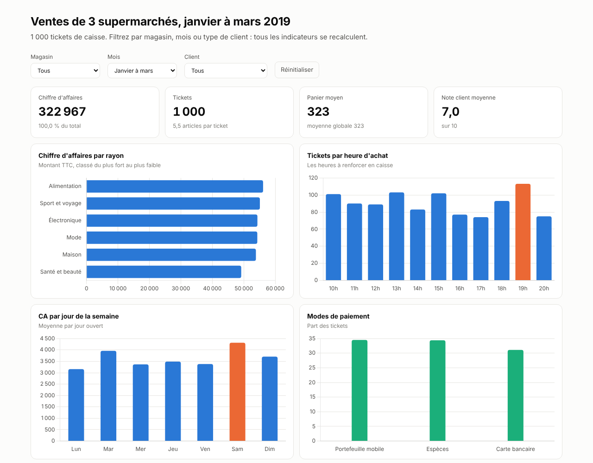
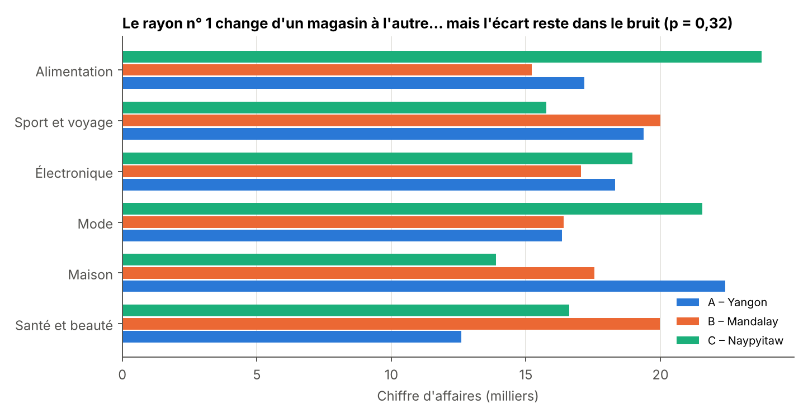
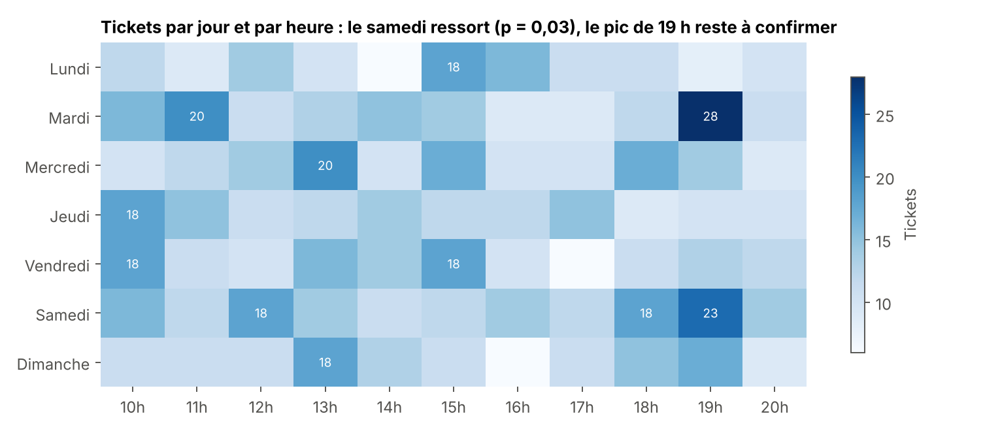
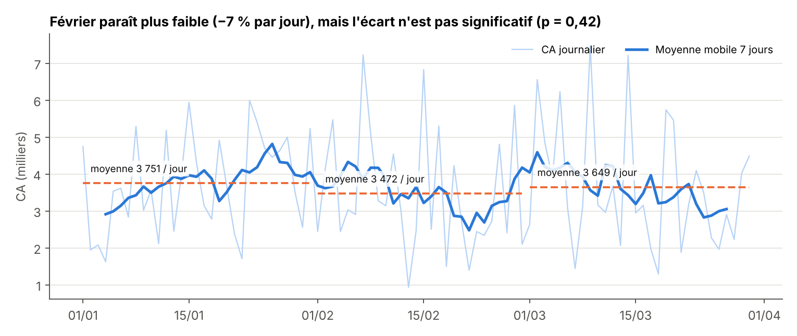

# Ventes de supermarché : quelles décisions les données permettent-elles vraiment ?

> **English summary**
>
> - **Problem:** a chain of 3 supermarkets wants to know where to invest (product lines, opening hours, loyalty card), based on 3 months of receipts.
> - **Data:** 1,000 public receipts (3 stores, January to March 2019): product line, amount, time, payment method, customer type, satisfaction rating.
> - **Method:** data quality checks and 8 business queries in SQL (DuckDB), then a statistical test (Python, SciPy) on every observed gap before turning it into a recommendation. Interactive dashboard with store, month and customer-type filters.
> - **Result:** most visible gaps are noise. Only one signal holds (Saturday), and the data cannot be used to manage margin.
>
> *The detailed write-up below is in French. Code, figures and results are language-independent.*

**SQL (DuckDB) · Python (pandas, SciPy) · tableau de bord interactif**

> - **Le problème :** une chaîne de 3 supermarchés veut savoir où investir (rayons, horaires, fidélité), à partir de 3 mois de tickets de caisse.
> - **Les données :** 1 000 tickets publics (3 magasins, janvier à mars 2019) : rayon, montant, heure, mode de paiement, type de client, note de satisfaction.
> - **La méthode :** contrôles qualité et 8 requêtes métier en SQL, puis tests statistiques sur chaque écart observé avant de le transformer en recommandation.
> - **Le résultat :** la plupart des écarts visibles relèvent du bruit. Un seul signal tient, le samedi. Et la base ne permet pas de piloter la marge.

**[▶ Ouvrir le tableau de bord interactif](https://emmanuelnoualeu.github.io/projets/supermarche/)** : filtres par magasin, mois et type de client.



---

## Pourquoi ce projet

Sur un tableau de bord, tout écart finit par ressembler à une tendance : le magasin C « fait mieux », février « décroche », les membres « dépensent plus ». Avec 3 mois d'historique, la question qui compte est de savoir **lesquels de ces écarts justifient une décision**. Ce projet montre la démarche que j'applique : décrire, puis tester, avant de recommander.

## Ce que révèlent les données

### 1. Contrôle qualité : une anomalie qui change le périmètre de l'analyse
Les 1 000 factures sont uniques, sans valeur manquante, et le montant TTC est toujours égal à prix × quantité × 1,05. En revanche, **le taux de marge brute vaut 4,76 % sur toutes les lignes** : la « marge » enregistrée n'est en fait que la taxe de 5 % recopiée. Il est donc **impossible d'analyser la rentabilité** par rayon ou par magasin avec cette base. L'analyse porte sur le chiffre d'affaires, et la première recommandation est de récupérer les coûts d'achat réels.

### 2. Les écarts entre magasins et entre rayons restent dans le bruit
Le magasin C fait 34 % du CA, contre 33 % pour A et pour B. Le rayon numéro 1 change d'un magasin à l'autre (Alimentation à C, Maison à A, Sport et voyage à B). Pourtant, aucun de ces écarts n'est significatif.



### 3. Le samedi est le seul signal qui ressort
Le samedi génère plus de chiffre d'affaires que les autres jours (p = 0,03), et le créneau de 19 h concentre le plus de tickets (113, contre 74 à 103 aux autres heures). Ce sont les deux pistes pour le planning des caisses. Elles restent à confirmer sur une période plus longue, car 9 tests ont été menés.



### 4. Le « creux de février » n'est pas démontré
Ramené au nombre de jours ouverts, février fait −7 % par jour. Mais la variabilité d'un jour à l'autre est telle que l'écart n'est pas significatif (p = 0,42).



### Synthèse des tests

| Question | Test | p-valeur | Conclusion (seuil 5 %) |
|---|---|---|---|
| Panier moyen différent selon le magasin | Kruskal-Wallis | 0,812 | Pas d'écart démontré |
| Panier moyen différent selon le rayon | Kruskal-Wallis | 0,827 | Pas d'écart démontré |
| Les membres dépensent plus que les non-membres | Mann-Whitney (unilatéral) | 0,296 | Pas d'écart démontré |
| Mode de paiement lié au magasin | Khi-deux d'indépendance | 0,509 | Pas d'écart démontré |
| CA journalier différent selon le jour de la semaine | Kruskal-Wallis | 0,354 | Pas d'écart démontré |
| Février plus faible (CA journalier) | Mann-Whitney | 0,424 | Pas d'écart démontré |
| **Le samedi fait plus de CA que les autres jours** | Mann-Whitney (unilatéral) | **0,033** | **Écart significatif** |
| Mix des rayons différent selon le magasin | Khi-deux d'indépendance | 0,316 | Pas d'écart démontré |
| Affluence non uniforme selon l'heure | Khi-deux d'adéquation | 0,050 | Limite, à confirmer |

## Recommandations

1. **Renforcer les caisses le samedi, notamment entre 18 h et 20 h.** C'est la seule décision appuyée par les données aujourd'hui.
2. **Ne pas réallouer les budgets par magasin ou par rayon** sur la base de ce trimestre : les écarts observés sont compatibles avec le hasard.
3. **Revoir le programme de fidélité.** Les membres ne dépensent pas plus que les autres clients (p = 0,30), donc la carte ne crée pas de valeur mesurable en l'état.
4. **Compléter la base :** coûts d'achat réels pour calculer la marge, et 12 mois d'historique pour mesurer la saisonnalité.

---

## Structure et reproduction

```bash
pip install -r requirements.txt
python src/executer_sql.py   # contrôles + 8 requêtes métier -> resultats/*.csv
python src/analyse.py        # tests statistiques, figures, données du tableau de bord
```

```
├── data/ventes_supermarche.csv        # données sources (1 000 tickets)
├── sql/
│   ├── 01_creation_et_controles.sql   # typage, doublons, valeurs manquantes, cohérence
│   └── 02_analyses.sql                # 8 questions métier (fenêtres, CTE, classements)
├── src/
│   ├── executer_sql.py                # exécute les scripts SQL avec DuckDB
│   └── analyse.py                     # tests, figures, export du tableau de bord
├── resultats/                         # sortie de chaque requête + tests statistiques
├── dashboard/                         # tableau de bord HTML (Chart.js), filtrable
└── figures/
```

**Techniques SQL utilisées :** fonctions de fenêtrage (`SUM() OVER`, `RANK() OVER (PARTITION BY)`), moyenne mobile, CTE, agrégations conditionnelles et contrôles de cohérence.

**Données :** jeu public « Supermarket sales » (3 magasins, Myanmar, janvier à mars 2019), largement utilisé pour l'apprentissage de l'analyse de données.

---

**Emmanuel Noualeu**, analyste de données et ingénieur minier · [Portfolio](https://emmanuelnoualeu.github.io) · [LinkedIn](https://www.linkedin.com/in/emmanuel-noualeu-b78bba24b/) · [Upwork](https://www.upwork.com/freelancers/~0146b1a5dfeefdd395) · [emmanuelnoualeu@gmail.com](mailto:emmanuelnoualeu@gmail.com)
